# Aegis SOC Command Center

Projekt portfolio Security Engineering: docelowo lokalna platforma mini-SIEM, SOAR,
Incident Response i Threat Hunting, z demonstracją opartą na prawdziwym pipeline logów.

**Stan: PHASE 2 — trwałe przyjmowanie zdarzeń, ukończona i zweryfikowana 2026-09-30.**
Backend ma API źródeł, osobne tokeny ingestion, single/batch, idempotencję,
PostgreSQL inbox/outbox, relay i worker z ograniczonym retry oraz kwarantanną.
Stan `staged` oznacza gotowość surowego zdarzenia do normalizacji w PHASE 3.
Nie ma jeszcze normalizacji, detekcji, wyszukiwania zdarzeń, UI ani generatora.
Zakres i wyniki kontroli: [walidacja](docs/validation.md).

## Najpierw przeczytaj

1. [Raport stanu początkowego i brakujące komponenty](docs/current-state-report.md).
2. [Docelowa architektura i diagramy](docs/architecture.md).
3. [Decyzje architektoniczne — ADR](docs/adr/README.md).
4. [Struktura katalogów](docs/repository-structure.md).
5. [Plan PHASE 0–20, zależności i kryteria odbioru](docs/implementation-plan.md).
6. [Macierz wymagań](docs/requirements-traceability.md).

## Docelowy przepływ

```mermaid
flowchart LR
    Sources[Log Sources] --> API[Ingestion API]
    API --> Inbox[Durable Inbox]
    Inbox --> Parser[Parser]
    Parser --> Normalize[Normalization]
    Normalize --> Storage[Event Storage]
    Storage --> Detection[Detection Engine]
    Detection --> Correlation[Correlation Engine]
    Correlation --> Risk[Risk Engine]
    Risk --> Alert[Alert]
    Alert --> Incident[Incident]
    Incident --> SOAR[SOAR Simulation]
    SOAR --> Report[Reporting]
```



Diagram pokazuje zależności logiczne. Mechanikę transakcji, projektowany stan
`DetectionMatch` przed publikacją alertu oraz opóźnioną projekcję ClickHouse opisuje
[architektura](docs/architecture.md).

## Wybrany stack

| Warstwa | Decyzja | Powód |
| --- | --- | --- |
| API i domena | Python 3.12.14, FastAPI, Pydantic, SQLAlchemy | Typowane kontrakty i testowalna logika domenowa |
| Frontend | React, TypeScript, Vite | Aplikacja analityczna SPA; SSR nie jest potrzebny |
| Stan operacyjny | PostgreSQL, Alembic | Transakcje, audyt, inbox/outbox, migracje |
| Archiwum zdarzeń | ClickHouse | Wyszukiwanie i agregacje dużych zbiorów logów |
| Praca asynchroniczna | Celery, Redis | Oddzielny worker, retry i ograniczanie ruchu |
| Uruchomienie | Docker Compose | Powtarzalne lokalne demo bez kont w chmurze |

Wersje backendu i hashe dystrybucji zapisano w [requirements.lock](backend/requirements.lock)
i [requirements-dev.lock](backend/requirements-dev.lock). Lokalny Python, obraz
kontenera i CI są przypięte do **3.12.14**. Zmianę wcześniejszego planu 3.13 uzasadnia
[ADR 0001](docs/adr/0001-modular-monolith.md). Frontend pozostaje planowany na PHASE 13
z Node 24; jego zależności nie są jeszcze instalowane.

## Kontrole lokalne

Walidacja struktury i dokumentacji wymaga Python 3.11+ bez bibliotek zewnętrznych:

```sh
python scripts/validate_repository.py
git diff --check
```

Na Windows z Python Launcher zamiast `python` można użyć `py`.
Walidator sprawdza strukturę, lokalne odnośniki, format tekstu i kompletność planu.
Nie zastępuje testów backendu, integracji ani bezpieczeństwa.

Testy backendu wymagają Python 3.12.14 i zależności z dev lockfile.
Instrukcję przygotowania środowiska, lint, kontroli typów i testów zawiera
[obsługa PHASE 1](docs/phase1-operations.md).

## Instalacja i Docker

Wymagane są działający Docker Engine i Compose v2 z kontenerami Linux.
Z katalogu głównego repozytorium:

```sh
python scripts/bootstrap_env.py
docker compose config --quiet
docker compose build api
docker compose up -d --wait
docker compose exec api python -m app.bootstrap --username admin
```

Bootstrap tworzy lokalny `.env` z losowymi sekretami i odmawia nadpisania istniejącego
pliku. Migrator wykonuje Alembic przed startem API. Pierwszy administrator podaje
hasło w ukrytym monicie terminala; nie ma stałego hasła demo. Reverse proxy udostępnia
API pod `http://localhost:8080/api/v1`; bazy i Redis pozostają w sieci Compose.
ClickHouse ma sondę gotowości, a jego schemat zdarzeń powstanie w PHASE 3.

Fundament zweryfikowano w PHASE 1. Konto administratora i profil lokalnego HTTP
opisuje [instrukcja fundamentu](docs/phase1-operations.md). Przyjmowanie zdarzeń,
status, retry i limity opisuje [obsługa PHASE 2](docs/phase2-operations.md).

## Dokumentacja funkcji i dalszy plan

Auth, RBAC, audyt i podstawowa obserwowalność działają od PHASE 1. PHASE 2
dodaje trwałe przyjmowanie surowych zdarzeń. Pozostałe moduły należą do kolejnych faz.

- [API i kontrakty błędów](docs/api-contract.md), [model i normalizacja](docs/data-model.md).
- [Detekcje, Sigma i testowanie reguł](docs/detection-engine.md).
- [Korelacja i attack storyline](docs/correlation-engine.md), [jawny risk scoring](docs/risk-engine.md).
- [Obsługa incydentów i evidence](docs/incident-response.md).
- [Threat Hunting](docs/threat-hunting.md) i lokalne IOC.
- [SOAR w trybie simulation](docs/soar.md).
- [JWT, RBAC, audyt i model zagrożeń](docs/security.md).
- [Obserwowalność i metryki SOC](docs/observability.md).
- [Siedem scenariuszy demo](docs/demo.md).

## Prezentacja portfolio i roadmap

Docelowe demo pozwoli przejść od surowego logu, przez uzasadnienie alertu, do
incydentu, timeline i wykonania playbooka. Scenariusze obejmą brute force, poprawne
logowanie po ataku, PowerShell, eskalację uprawnień, trafienie IOC, account compromise
i nowe konto administratora. Każdy scenariusz zostanie powiązany z testami regresji.

Screenshoty rzeczywistego dashboardu trafią do `docs/assets/` w PHASE 13/18.
Pełna definicja ukończenia pozostaje otwarta do PHASE 20. Po zweryfikowaniu PHASE 2
następny etap to **PHASE 3 — normalizacja i wyszukiwanie zdarzeń**.

## Zasady rozwoju

Po każdej fazie: adekwatne testy, lint/format, integracja, poprawki, dokumentacja,
logiczny Conventional Commit. Uszkodzona bramka zatrzymuje fazy zależne. Nie stosujemy
force push. Szczegóły: [CONTRIBUTING](CONTRIBUTING.md).
