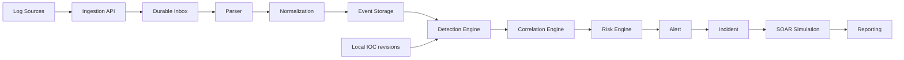

# Aegis SOC Command Center

Projekt portfolio Security Engineering: docelowo lokalna platforma mini-SIEM, SOAR,
Incident Response i Threat Hunting, z demonstracją opartą na prawdziwym pipeline logów.

**Stan: PHASE 0–3 i Etapy 1–9 ukończone lokalnie — 2026-10-07.**
Backend ma API źródeł, osobne tokeny ingestion, single/batch, idempotencję,
PostgreSQL inbox/outbox, relay i worker z ograniczonym retry oraz kwarantanną.
Sześć parserów tworzy niezmienne snapshoty w PostgreSQL, a osobny processor
projektuje je do ClickHouse. API wyszukuje logi z filtrowaniem i deduplikacją.
Działają trzy wbudowane detekcje pojedynczych zdarzeń, trwałe alerty z dowodami
i decyzjami analityka oraz panel React obsługujący rzeczywiste API.
Moduł incydentów dodaje sprawy z wieloma alertami, właścicielem, statusami,
tagami, notatkami, trwałymi dowodami i historią. Nowe High/Critical alerty
automatycznie tworzą sprawę do oceny analityka.
Korelacja dodaje pięć wersjonowanych reguł liczników i sekwencji, okna czasu,
AND/OR oraz wspólne encje. Alert zachowuje wszystkie dowody; panel umożliwia
odczyt, kontrolowane włączenie reguły i izolowany test. Osobny correlator
finalizuje live z buforem 120 s; zamknięty replay ma własny manifest.
Etap 3 dodaje ocenę ryzyka 0–100, jawne wkłady i historię obliczeń alertów
i incydentów. Brakujący kontekst pozostaje nieznany; punktacja nie oznacza
prawdopodobieństwa ataku. [Polityka ryzyka](docs/risk-engine.md).
Etap 4 dodaje lokalny wersjonowany katalog MITRE ATT&CK, nazwy technik/taktyk
w regułach i dowodach oraz widok pokrycia z licznikami alertów i spraw.
Mapowania są wskazówką do analizy, bez potwierdzania ataku.
[Zakres i zasady](docs/mitre.md). Etap 5 dodaje import, walidację, niezmienne
rewizje i kontrolowane wykonanie reguł Sigma. [Podzbiór i zasady](docs/sigma.md),
[walidacja Etapu 5](docs/validation-sigma.md).
Etap 6 dodaje profile obserwowanych użytkowników, hostów, IP i procesów:
aktywność, alerty, sprawy, role, first/last seen, powiązane hosty oraz
wyjaśnienie najwyższej kwalifikującej się istniejącej oceny alertu.
Tożsamość i niepełność indeksu są jawne; starsze dane administrator indeksuje
ograniczonymi partiami. [Zasady profili](docs/entities.md),
[walidacja Etapu 6](docs/validation-entities.md).
Etap 7 dodaje lokalny katalog IP, domen, URL i hash, niezmienne rewizje,
dokładne sprawdzenie i atomowy import. Detektor zachowuje dowód pierwszego
dopasowania, także pustego; malicious IOC tworzy medium alert do analizy.
Reputacja i confidence są deklaracją źródła. Osobny wkład I w risk-policy-v4
ma maksimum 15, a brak TI zachowuje dotychczasową politykę v3. Panel pokazuje
katalog, historię i oryginalne dopasowane pola. Dostępny provider jest lokalny;
aplikacja nie pobiera URL ani reputacji z zewnętrznych usług.
[Zakres i ograniczenia](docs/intelligence.md),
[walidacja Etapu 7](docs/validation-intelligence.md).
Generator pozostaje zaplanowany. Rozbudowa przebiega według
[audytu i nowego planu 15 etapów](docs/soc-expansion-plan.md).
Zakres: [incydenty](docs/incidents.md), [pierwsze alerty i panel](docs/initial-soc.md).
Wyniki bieżącego przyrostu: [walidacja Etapu 9](docs/validation-ueba.md).
Etap 9 dodaje [analizę zachowania użytkowników i hostów](docs/ueba.md):
porównanie dnia z 28-dniową historią, score, wyjaśnienie i zweryfikowane
dowody. Jawnie pokazuje brak historii oraz nieobsługiwane fakty uprawnień.
2181 testów backendu i 286 panelu PASS; lokalne wdrożenie i restart sprawdzone.
Historyczny wynik Etapu 8: [raport chronologii](docs/validation-attack-timeline.md).
Etap 8 dodaje [chronologię zdarzeń sprawy](docs/attack-timeline.md), otwieranie
oryginalnego logu i wszystkie odniesienia alertów. Stan na 2026-10-06:
2062 testy backendu i 238 panelu PASS; lokalne uruchomienie, zachowanie danych
i restart procesów potwierdzone. Ograniczenia dowodu opisuje raport.
Historyczne wyniki: [walidacja Etapu 7](docs/validation-intelligence.md),
[walidacja Etapu 6](docs/validation-entities.md),
[walidacja Etapu 5](docs/validation-sigma.md),
[walidacja Etapu 4](docs/validation-mitre.md),
[walidacja Etapu 3](docs/validation-risk.md),
[walidacja Etapu 2](docs/validation-correlation.md),
wcześniejszy [Etap 1](docs/validation-incidents.md).

## Start z folderu na Windows

Uruchom Docker Desktop w trybie kontenerów Linux, a następnie kliknij dwukrotnie
[Uruchom Aegis.cmd](Uruchom%20Aegis.cmd). Skrypt przygotuje konfigurację,
zbuduje panel i backend oraz uruchomi lokalne usługi. Panel wymaga Node.js 24.19.0
i pnpm 11.19.0; launcher rozpoznaje także dostępny runtime Codex. Przy pierwszym starcie poprosi
o ustawienie hasła administratora `admin` w ukrytym monicie. Kolejne uruchomienia
zachowują konta, hasła, konfigurację i dane. Zwykły start online nie wymaga
instalacji Pythona na Windows.

Sprawdź przyjmowanie zdarzeń. W PowerShell, w tym folderze:

```powershell
powershell -NoProfile -ExecutionPolicy Bypass -File .\scripts\aegis.ps1 -Action check
```

Kontrola prosi o hasło istniejącego administratora i sprawdza trwały zapis,
idempotencję, normalizację i odczyt z archiwum. API działa pod
`http://localhost:8080/api/v1`, a panel pod [localhost:8080](http://localhost:8080).
Zaloguj się kontem utworzonym przez launcher.

Start, stan usług, zatrzymanie, tryb offline i rozwiązywanie problemów:
[lokalna instrukcja krok po kroku](docs/local-start.md).

## Najpierw przeczytaj

1. [Raport stanu początkowego i brakujące komponenty](docs/current-state-report.md).
2. [Docelowa architektura i diagramy](docs/architecture.md).
3. [Decyzje architektoniczne — ADR](docs/adr/README.md).
4. [Struktura katalogów](docs/repository-structure.md).
5. [Plan PHASE 0–20, zależności i kryteria odbioru](docs/implementation-plan.md).
6. [Macierz wymagań](docs/requirements-traceability.md).

## Docelowy przepływ



Diagram pokazuje zależności logiczne. Mechanikę transakcji, projektowany stan
`DetectionMatch` przed publikacją alertu oraz opóźnioną projekcję ClickHouse opisuje
[architektura](docs/architecture.md).

## Wybrany stack

| Warstwa | Decyzja | Powód |
| --- | --- | --- |
| API i domena | Python 3.12.14, FastAPI, Pydantic, SQLAlchemy | Typowane kontrakty i testowalna logika domenowa |
| Frontend | React, TypeScript, Vite | Aplikacja analityczna SPA; SSR nie jest potrzebny |
| Stan operacyjny | PostgreSQL, Alembic | Transakcje, audyt, inbox/outbox, migracje |
| Archiwum zdarzeń | ClickHouse | Wyszukiwanie i agregacje dużych zbiorów logów |
| Praca asynchroniczna | Celery, Redis | Oddzielny worker, retry i ograniczanie ruchu |
| Uruchomienie | Docker Compose | Powtarzalne lokalne demo bez kont w chmurze |

Wersje backendu i hashe dystrybucji zapisano w [requirements.lock](backend/requirements.lock)
i [requirements-dev.lock](backend/requirements-dev.lock). Lokalny Python, obraz
kontenera i CI są przypięte do **3.12.14**. Zmianę wcześniejszego planu 3.13 uzasadnia
[ADR 0001](docs/adr/0001-modular-monolith.md). Działający panel używa React,
TypeScript i Vite; Node 24.19.0 i pnpm 11.19.0 są przypięte w konfiguracji frontendu.

## Kontrole lokalne

Walidacja struktury i dokumentacji wymaga Python 3.12+ bez bibliotek zewnętrznych:

```sh
python scripts/validate_repository.py
git diff --check
```

Na Windows z Python Launcher zamiast `python` można użyć `py`.
Walidator sprawdza strukturę, lokalne odnośniki, format tekstu i kompletność planu.
Nie zastępuje testów backendu, integracji ani bezpieczeństwa.

Testy backendu wymagają Python 3.12.14 i zależności z dev lockfile.
Instrukcję przygotowania środowiska, lint, kontroli typów i testów zawiera
[obsługa PHASE 1](docs/phase1-operations.md).

## Instalacja i Docker

Wymagane są działający Docker Engine i Compose v2 z kontenerami Linux.
Na Windows użyj [lokalnego launchera](docs/local-start.md). Ręczny start
z katalogu głównego repozytorium:

```sh
python scripts/bootstrap_env.py
cd frontend
pnpm install --frozen-lockfile --ignore-scripts
pnpm build
cd ..
docker compose config --quiet
docker compose build api
docker compose up -d --wait
docker compose exec api python -m app.bootstrap --username admin
```

Bootstrap tworzy lokalny `.env` z losowymi sekretami i odmawia nadpisania istniejącego
pliku. Migrator wykonuje Alembic przed startem API. Pierwszy administrator podaje
hasło w ukrytym monicie terminala; nie ma stałego hasła demo. Reverse proxy udostępnia
API pod `http://localhost:8080/api/v1`; bazy i Redis pozostają w sieci Compose.
ClickHouse ma sondę gotowości i wersjonowane migracje archiwum zdarzeń.

Fundament zweryfikowano w PHASE 1. Konto administratora i profil lokalnego HTTP
opisuje [instrukcja fundamentu](docs/phase1-operations.md). Przyjmowanie zdarzeń,
status, retry i limity opisuje [obsługa PHASE 2](docs/phase2-operations.md).

## Dokumentacja funkcji i dalszy plan

Auth, RBAC, audyt i podstawowa obserwowalność działają od PHASE 1. PHASE 2
dodaje trwałe przyjmowanie surowych zdarzeń, PHASE 3 normalizację i wyszukiwanie,
a pierwszy przyrost SOC trzy detekcje, alerty i panel. Aktualną kolejność
rozbudowy wyznacza [plan 15 etapów](docs/soc-expansion-plan.md).

- [API i kontrakty błędów](docs/api-contract.md), [model i normalizacja](docs/data-model.md).
- [Detekcje, Sigma i testowanie reguł](docs/detection-engine.md).
- [Korelacja i attack storyline](docs/correlation-engine.md), [jawny risk scoring](docs/risk-engine.md).
- [Obsługa incydentów i evidence](docs/incident-response.md).
- [Lokalny katalog IOC i dowody dopasowania](docs/intelligence.md).
- [Graficzna chronologia zdarzeń incydentu](docs/attack-timeline.md).
- [Analiza zachowania użytkowników i hostów](docs/ueba.md).
- [Threat Hunting](docs/threat-hunting.md).
- [SOAR w trybie simulation](docs/soar.md).
- [JWT, RBAC, audyt i model zagrożeń](docs/security.md).
- [Obserwowalność i metryki SOC](docs/observability.md).
- [Siedem scenariuszy demo](docs/demo.md).

## Prezentacja portfolio i roadmap

Docelowe demo pozwoli przejść od surowego logu, przez uzasadnienie alertu, do
incydentu, timeline i wykonania playbooka. Scenariusze obejmą brute force, poprawne
logowanie po ataku, PowerShell, eskalację uprawnień, trafienie IOC, account compromise
i nowe konto administratora. Każdy scenariusz zostanie powiązany z testami regresji.

Screenshoty rzeczywistego dashboardu trafią do `docs/assets/` w PHASE 13/18.
Pełna definicja ukończenia pozostaje otwarta.
Ukończony przyrost nowego planu: **Etap 9 — UEBA**;
2181 testów backendu i 286 panelu PASS, lokalne wdrożenie sprawdzone.
Etapy 1–8 mają osobne raporty powyżej. Zalogowany test przeglądarkowy,
internetowy audyt zależności i hostowane CI pozostają otwarte, zgodnie z raportem.
Bramkę bieżącego przyrostu opisuje [raport Etapu 9](docs/validation-ueba.md).
Następny przyrost: **Mini SOAR**.

## Zasady rozwoju

Po każdej fazie: adekwatne testy, lint/format, integracja, poprawki, dokumentacja,
logiczny Conventional Commit. Uszkodzona bramka zatrzymuje fazy zależne. Nie stosujemy
force push. Szczegóły: [CONTRIBUTING](CONTRIBUTING.md).
