# Aegis SOC Command Center

Projekt portfolio Security Engineering: docelowo lokalna platforma mini-SIEM, SOAR,
Incident Response i Threat Hunting, z demonstracją opartą na prawdziwym pipeline logów.

**Stan: PHASE 0 — architektura i szkielet repozytorium.** Nie ma jeszcze działającego
API, UI, generatora ani wdrożenia Docker Compose. Opis funkcji poniżej to projekt
docelowy, a nie deklaracja ich implementacji. Nie publikujemy fikcyjnych screenshotów
ani odznaki zielonego CI. Raport z lokalnych kontroli: [walidacja](docs/validation.md).

## Najpierw przeczytaj

1. [Raport stanu początkowego i brakujące komponenty](docs/current-state-report.md).
2. [Docelowa architektura i diagramy](docs/architecture.md).
3. [Decyzje architektoniczne — ADR](docs/adr/README.md).
4. [Struktura katalogów](docs/repository-structure.md).
5. [Plan PHASE 0–20, zależności i kryteria odbioru](docs/implementation-plan.md).
6. [Macierz wymagań](docs/requirements-traceability.md).

## Docelowy przepływ

```mermaid
flowchart LR
    Sources[Log Sources] --> API[Ingestion API]
    API --> Inbox[Durable Inbox]
    Inbox --> Parser[Parser]
    Parser --> Normalize[Normalization]
    Normalize --> Storage[Event Storage]
    Storage --> Detection[Detection Engine]
    Detection --> Correlation[Correlation Engine]
    Correlation --> Risk[Risk Engine]
    Risk --> Alert[Alert]
    Alert --> Incident[Incident]
    Incident --> SOAR[SOAR Simulation]
    SOAR --> Report[Reporting]
```



Diagram pokazuje zależności logiczne. Mechanikę transakcji, projektowany stan
`DetectionMatch` przed publikacją alertu oraz opóźnioną projekcję ClickHouse opisuje
[architektura](docs/architecture.md).

## Wybrany stack

| Warstwa | Decyzja | Powód |
| --- | --- | --- |
| API i domena | Python, FastAPI, Pydantic, SQLAlchemy | Typowane kontrakty i testowalna logika domenowa |
| Frontend | React, TypeScript, Vite | Aplikacja analityczna SPA; SSR nie jest potrzebny |
| Stan operacyjny | PostgreSQL, Alembic | Transakcje, audyt, inbox/outbox, migracje |
| Archiwum zdarzeń | ClickHouse | Wyszukiwanie i agregacje dużych zbiorów logów |
| Praca asynchroniczna | Celery, Redis | Oddzielny worker, retry i ograniczanie ruchu |
| Uruchomienie | Docker Compose | Powtarzalne lokalne demo bez kont w chmurze |

Dokładne wersje i lockfile powstaną z pierwszą działającą zależnością w PHASE 1
(frontend w PHASE 13), po kontroli kompatybilności i podatności. Docelowe środowisko
backendu: Linux/Python 3.13; frontend: Node 24. PHASE 0 nie instaluje bibliotek aplikacji.

## Co można uruchomić teraz

Wymaganie: Python 3.11+; bez bibliotek zewnętrznych.

```sh
python scripts/validate_repository.py
git diff --check
```

Na Windows z Python Launcher zamiast `python` można użyć `py`.
Walidator sprawdza strukturę, lokalne odnośniki, format tekstu i kompletność planu.
Nie zastępuje testów backendu, integracji ani bezpieczeństwa.

## Instalacja i Docker — plan

Docelowo bootstrap wygeneruje lokalne sekrety, migrator wykona Alembic i migracje
ClickHouse, a `docker compose up --build` uruchomi platformę. **Ta komenda nie jest
jeszcze dostępna w tym etapie.** Nie ma domyślnego hasła administratora. Pierwsze
konto powstanie przez jednorazowy bootstrap, nie przez seed z hasłem w Git.
Usługi baz i kolejki pozostaną wewnątrz sieci Compose.

## Funkcje zaplanowane

- [API i kontrakty błędów](docs/api-contract.md), [model i normalizacja](docs/data-model.md).
- [Detekcje, Sigma i testowanie reguł](docs/detection-engine.md).
- [Korelacja i attack storyline](docs/correlation-engine.md), [jawny risk scoring](docs/risk-engine.md).
- [Obsługa incydentów i evidence](docs/incident-response.md).
- [Threat Hunting](docs/threat-hunting.md) i lokalne IOC.
- [SOAR w trybie simulation](docs/soar.md).
- [JWT, RBAC, audyt i model zagrożeń](docs/security.md).
- [Obserwowalność i metryki SOC](docs/observability.md).
- [Siedem scenariuszy demo](docs/demo.md).

## Prezentacja portfolio i roadmap

Docelowe demo pozwoli przejść od surowego logu, przez uzasadnienie alertu, do
incydentu, timeline i wykonania playbooka. Scenariusze obejmą brute force, poprawne
logowanie po ataku, PowerShell, eskalację uprawnień, trafienie IOC, account compromise
i nowe konto administratora. Każdy scenariusz zostanie powiązany z testami regresji.

Screenshoty rzeczywistego dashboardu trafią do `docs/assets/` w PHASE 13/18.
Pełna definicja ukończenia pozostaje otwarta do PHASE 20. Następny etap:
**PHASE 1 — fundament backendu, konfiguracja, migracje, auth/RBAC i infrastruktura**.

## Zasady rozwoju

Po każdej fazie: adekwatne testy, lint/format, integracja, poprawki, dokumentacja,
logiczny Conventional Commit. Uszkodzona bramka zatrzymuje fazy zależne. Nie stosujemy
force push. Szczegóły: [CONTRIBUTING](CONTRIBUTING.md).
