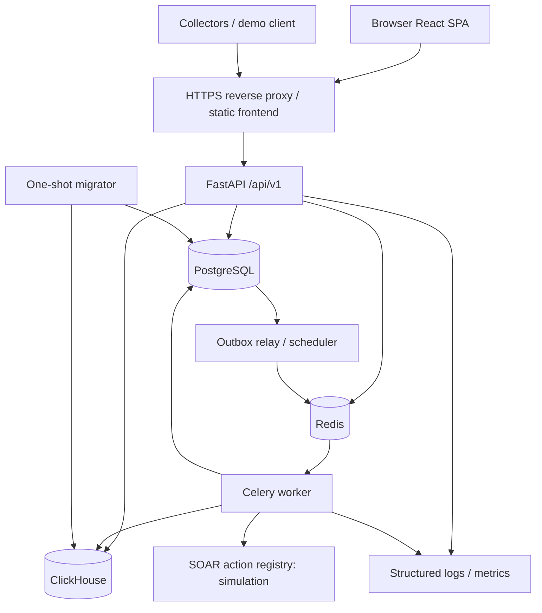

# Architektura docelowa

Status 2026-10-03: fundament PHASE 1–3, pojedyncze detekcje, panel,
incydenty i korelacja Etapu 2 są zaimplementowane; Etap 3 ryzyka jest w walidacji.
PostgreSQL przechowuje
niezmienne normalized snapshots; processor projektuje je do ClickHouse,
a detector i correlator niezależnie oceniają fakty z PostgreSQL.
Correlator publikuje alert z wieloma dowodami oraz automatyczną sprawę
High/Critical w jednej transakcji. Finalizację opisuje
[ADR 0008](adr/0008-temporal-correlation.md), a wykonane kontrole
[raport Etapu 2](validation-correlation.md).
Poniższe diagramy i zakres dalszych modułów zachowują architekturę docelową
PHASE 0; IOC, SOAR, graf/merge i generator pozostają projektem.
Ocena ryzyka jest czystym modułem wywoływanym przy zapisie alertów i zmianach
dowodów sprawy, bez osobnej usługi. Niezmienne obliczenia, bieżąca projekcja
i audyt mają jedną transakcję; odczyt nie przelicza stanu.
[ADR 0009](adr/0009-explainable-risk.md) określa deduplikację i brak kontekstu.
Szczegóły rozstrzygnięć:
[ADR](adr/README.md). Poziom produkcyjny oznacza świadome kontrakty, odporność i testy,
nie deklarację wysokiej dostępności klastra uruchamianego na jednym laptopie.

## Zakres i budżet złożoności

Jedna organizacja i jeden lokalny deployment. Modularny monolit: wspólne typy,
model domeny i repozytoria; osobne procesy API, worker oraz scheduler/outbox relay
z tego samego obrazu. Frontend to SPA React/TypeScript budowane Vite. Bez Kafka,
Kubernetes, Elasticsearch, LLM i mikroserwisów w pierwszym wydaniu.

Projektowy punkt startowy, do pomiaru w PHASE 15/20: 4 vCPU, 8 GB RAM dla Docker,
20 GB wolnego dysku; 100 events/s przez 10 minut, burst 500 events/s przez 60 s,
1 mln zdarzeń w archiwum. To **cele testu**, nie potwierdzone osiągi. Przy utracie
pojemności API odmawia przyjęcia zamiast potwierdzać nietrwały zapis.

## Kontenery i granice zaufania

Tylko reverse proxy publikuje port na loopback hosta. Backend, PostgreSQL,
ClickHouse i Redis korzystają z wewnętrznej sieci Compose. HTTPS z lokalnym zaufanym
certyfikatem stanowi profil docelowy; ewentualny profil developerski HTTP ma być
jawnie oddzielony i ograniczony do localhost. Bootstrap sekretów i migrator są
jednorazowymi poleceniami, nie mechanizmem tworzenia tabel przy każdym starcie API.
Nazwane wolumeny przechowują dane poza katalogiem OneDrive. Obraz nie ma dostępu
do Docker socket ani poświadczeń prawdziwej infrastruktury.

## Odpowiedzialność komponentów

| Komponent | Własność | Nie służy do |
| --- | --- | --- |
| PostgreSQL | Użytkownicy, sesje, konfiguracja, inbox/outbox, stan detekcji, alerty, incydenty, evidence, IOC, hunts, runs, audyt | Bezterminowego przechowywania całego wolumenu surowych logów |
| ClickHouse | Archiwum raw/normalized, filtrowanie, agregacje i projekcja annotations reguł/MITRE | Transakcyjnego stanu incydentów ani gwarancji jednokrotnego alertowania |
| Redis | Transport zadań Celery, rate limiting, odtwarzalne cache | Jedynej kopii przyjętych logów, stanu okien lub historii SOAR |
| API | Auth, walidacja, autoryzacja, kontrakt REST, trwałe przyjęcie komend | Przetwarzania długich batchy w żądaniu HTTP |
| Worker | Parsery, normalizacja, detekcja, projekcje i symulowane playbooki | Dowolnego kodu z reguł lub wywołań shell |
| Scheduler/relay | Opróżnianie outbox, odzyskiwanie lease, bariery czasu i retencja | Tworzenia wyników poza kontrolą idempotencji |

## Pipeline i transakcje

1. `POST /api/v1/events` sprawdza credential źródła, limity, format i klucz
   idempotencji. W jednej transakcji PostgreSQL zapisuje batch, inbox records oraz
   outbox. Odpowiedź `202 Accepted` oznacza trwałe przyjęcie, nie zakończoną detekcję.
2. Relay publikuje **identyfikatory**, nie sekrety ani pełne payloady, do Celery.
   Opublikowanie i oznaczenie outbox nie jest transakcją z Redis: dopuszczamy retry.
3. Worker pobiera rekord pod lease z fencing tokenem. Parser wytwarza wspólny
   schema; niepoprawny record trafia do kwarantanny z kodem błędu. Normalized event,
   wersje parsera/schema i outbox projekcji są utrwalane razem. Batch udostępnia
   liczby accepted/normalized/quarantined/processed/projected oraz błędy per record.
4. Domena ocenia unikalne normalized events ze stanem okien w PostgreSQL. Logiczne
   `DetectionMatch` zawiera evidence, wersję reguły i explanation. Nie jest jeszcze
   osobnym publicznym alertem. Rozdzielenie umożliwia atomową publikację wyniku.
5. W transakcji zapisu efektów dopasowania korelacja wybiera lub zakłada case,
   risk engine liczy wkłady, a alert, powiązania, timeline, stan incydentu i audyt
   stają się widoczne razem. Do wdrożenia PHASE 6 działa sam alert bez case.
6. Projekcja do ClickHouse ma oddzielne retry i checkpoint. Dane mogą być chwilowo
   niewidoczne w explorerze, ale evidence alertu jest od razu dostępne z PostgreSQL.
   UI pokazuje opóźnienie indeksowania. ClickHouse outage nie unieważnia już
   potwierdzonego ingestu; po przekroczeniu limitu backlog nowe batche dostają `503`.
7. SOAR konsumuje utrwaloną komendę/run; każdy krok zapisuje wynik i audyt.
   Raportowanie operacyjne czyta PostgreSQL, log analytics — ClickHouse.

Celery/Redis nie dają wspólnej transakcji z bazą. Wybieramy **at-least-once delivery**
i idempotentne efekty domenowe, nie marketingowe „exactly once”. Checkpointy i sweeper
w PostgreSQL odzyskują pracę nawet po utracie kolejki. Ustawienia ACK i lease
wymagają testów worker-kill; [Celery opisuje redelivery i idempotencję](https://docs.celeryq.dev/en/stable/userguide/tasks.html).

## Tożsamość, deduplikacja i historia

- `source_id` pochodzi z credential, a nie z dowolnego pola klienta.
- `(source_id, dataset_id, mode, run_id, idempotency_key)` identyfikuje batch; ten sam klucz z innym
  hashem body zwraca `409`. Źródło zachowuje klucz przy ponowieniu transportu.
- `event_id` jest nadawanym przez serwer UUID. Opcjonalny stabilny
  `source_event_id` daje unikalność w obrębie source/dataset/mode/run. Dla live
  `run_id` ma stałą wartość namespace. Replay istniejącego archiwum referencjonuje
  oryginalne event IDs przez manifest, zamiast ponownie je ingestować. Bez ID nie usuwamy
  identycznych treści: dwie rzeczywiste próby logowania mogą wyglądać tak samo.
- Identyfikator eventu, timestamp i pola klucza sortowania ClickHouse pozostają
  niezmienne przy retry. Wersje normalizacji i adnotacji nie zmieniają tożsamości.
- Detekcja ma klucz logiczny obejmujący namespace, rule version, grupę i kotwicę
  lub suppression bucket. Unikalne constraints oraz blokady chronią współbieżność.
- Zapis alertu utrwala użyte evidence i wersje wzbogacenia. Zmiana IOC lub reguły
  nie przepisuje historii bez jawnego replay i nowej rewizji wyniku.

## Czas, replay i demo

Wszystkie czasy UTC; odróżniamy `timestamp` źródła, `received_at`, `processed_at`
i `detected_at`. Event-time służy do reguł; wall-clock do kolejek i pomiaru opóźnień.
Okna, watermark oparty na zamkniętej barierze ingestu, allowed lateness 120 s,
future skew 30 s i replay opisuje [detection engine](detection-engine.md).

`dataset_id` oraz `mode/run_id` oddzielają live od skończonego demo/replay. Demo
korzysta z tego samego API, parserów i funkcji domeny. Zamknięcie wejścia daje
deterministyczną finalizację bez zmiany zegara API i bez oczekiwania kilkunastu minut.
Replay nie dopisuje po cichu wyników do live incydentów ani live metryk.

## Storage, retencja i odtwarzanie

Domyślna polityka projektowa: archiwum eventów 30 dni, przetworzony inbox 24 h
po potwierdzonej projekcji i zużyciu przez detekcję, rejestr dedupe 30 dni,
quarantine 7 dni, alerty/cases/evidence 180 dni od zamknięcia sprawy, audyt 365 dni.
Otwarte i ponownie otwarte sprawy chronią evidence przed usunięciem. Alert bez
sprawy liczy 180 dni od utworzenia; powiązanie ze sprawą przejmuje jej retencję. Nieprzetworzone
rekordy nie są usuwane przez TTL. Retencja stanu detekcji obejmuje maksymalny
span reguł i lateness; [kontrakt](detection-engine.md) określa zakres replay.
Odpowiedzi API podają brak dostępnego zakresu zamiast pustego pozornego wyniku.

Snapshot evidence powiązany z case przeżywa TTL archiwum. Referencja zewnętrzna
bez zapisanej treści nie jest dowodem dostępności. Backup PostgreSQL obejmuje
stan, evidence i outbox; backup ClickHouse osobny punkt odtworzenia. PHASE 20
wymaga restore drill i sprawdzenia referencji między magazynami. RPO/RTO pozostają
niezmierzone; pojedynczy host nie zapewnia odporności na utratę całego urządzenia.

Docelowo ClickHouse `ReplacingMergeTree` dla niezmiennych eventów/retry, z jawną
deduplikacją w zapytaniach (`FINAL` lub sprawdzony odpowiednik) i testem zgodności
liczników po retry. Same merge w tle nie gwarantują braku duplikatów:
[dokumentacja silnika](https://clickhouse.com/docs/reference/engines/table-engines/mergetree-family/replacingmergetree).
Duże zmiany projekcji wymagają nowej wersji tabeli i odbudowy, nie mutacji na gorąco.

PostgreSQL migruje Alembic; wygenerowaną migrację należy zrecenzować i przetestować.
ClickHouse ma osobne numerowane SQL i tabelę wykonanych migracji z checksum.
Nie zakładamy atomowej migracji obu baz. Migrator jest pojedynczy i blokowany;
zmiany schematu stosują expand → deploy → contract. Zobacz
[Alembic](https://alembic.sqlalchemy.org/en/latest/tutorial.html).

## Modularność i kierunek zależności

`api → application services → domain → ports`; adaptery implementują ports.
Domena detekcji, korelacji i ryzyka nie importuje FastAPI ani Celery. Repozytorium
SQLAlchemy zarządza unit-of-work; nie ma ukrytych commitów w parserach.
Ingest nie pisze bezpośrednio do tabel incydentów. SOAR wywołuje autoryzowane usługi,
nie omija ich bezpośrednim SQL. Unikamy ogólnego frameworka pluginów przed drugim
rzeczywistym adapterem. Podział katalogów: [struktura](repository-structure.md).

## Granice pierwszego wydania

Brak HA, multi-tenancy, aktywnego blokowania IP, agentów EDR i zewnętrznych API TI.
Nie wymuszamy pełnej zgodności ECS/Sigma/OTel. Brak gwarancji forensic WORM wobec
administratora bazy. Nie obiecujemy przepustowości przed benchmarkiem. Wyjścia do
skalowania to partycjonowanie inbox, grup detekcji i projekcji oraz repliki storage;
każde wymaga nowego ADR i testów spójności, a nie tylko zwiększenia worker count.

## Wdrożony przyrost PHASE 2

`POST /api/v1/events` używa osobnego tokenu źródła. Jedna transakcja PostgreSQL
zapisuje raw, batch, uporządkowane członkostwo, outbox, liczniki pojemności i audyt.
Odpowiedź 202 potwierdza trwałość tej transakcji. API nie publikuje do Celery.
Proces `relay` publikuje wyłącznie UUID i generację zadania, a sweeper ponawia
niedokończoną pracę także po skutecznej publikacji, aby odzyskać utraconą kolejkę.
Worker sprawdza integralność i treść, następnie zapisuje `staged` lub błąd.

Blokada pojedynczego licznika pojemności serializuje admission oraz ręczny retry;
to świadomy koszt lokalnego, ograniczonego wolumenem systemu. Rekordy raw, batch
i członkostwa są niemodyfikowalne dla roli runtime. Limity obejmują dane już
przetworzone i metadane kolejnych batchy z duplikatami. Brak automatycznej retencji
jest jawny: PHASE 3 wprowadzi cykl życia po normalizacji i projekcji. Aktualne
limity, stany i obsługę awarii opisuje [instrukcja PHASE 2](phase2-operations.md).
