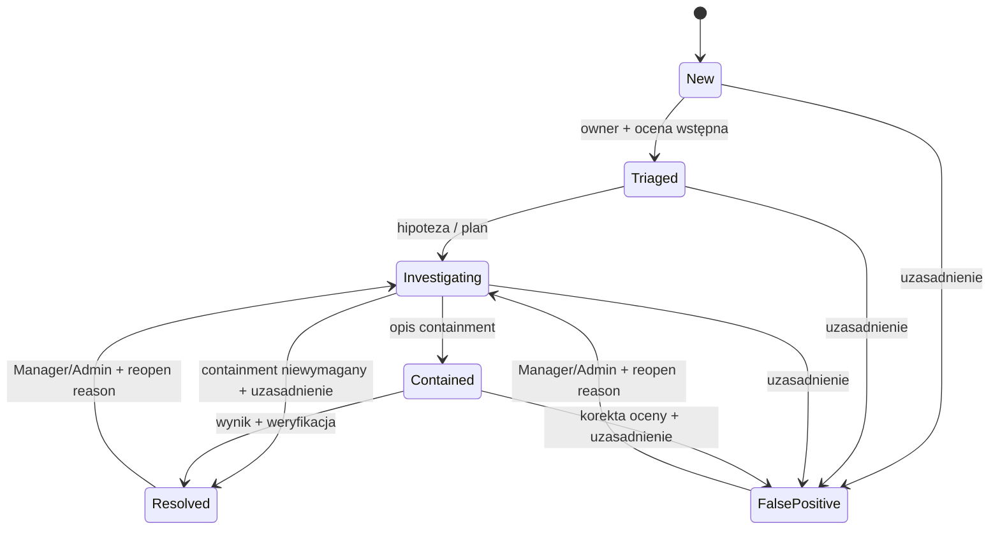

# Incident Response i case management

Aktualizacja 2026-10-01: Incident Management jest implementowany jako etap 1
[nowego planu rozbudowy](soc-expansion-plan.md). Bieżące statusy wymagane przez
użytkownika to `new`, `investigating`, `contained`, `resolved`, `closed`;
zastępują proponowane poniżej stany starego projektu. Decyzję opisuje
[ADR 0007](adr/0007-incident-case-management.md), a wyniki kontroli
[raport etapu 1](validation-incidents.md).

Poniższy dokument zachowuje **historyczny projekt PHASE 0**, w tym przyszłe
investigations, IOC, verdict, retencję i metryki. Sam opis tych funkcji nie
oznacza ich wdrożenia. Bieżący kod i raport etapu mają pierwszeństwo.

## Alert, investigation i incident

Alert jest udokumentowanym wynikiem reguły. Investigation jest roboczym zbiorem hipotez, bookmarków i dowodów utworzonym przez analityka, także wtedy, gdy nie ma jeszcze alertu. Incident reprezentuje sprawę wymagającą obsługi SOC, z właścicielem, statusem i rozstrzygnięciem. Jeden alert nie musi automatycznie tworzyć nowego incydentu. Korelacja lub jawna decyzja analityka wiąże alerty w sprawę zgodnie z [modelem korelacji](correlation-engine.md).

Investigation ma `id`, title, hypothesis, owner, `open/closed`, zapytania i ich wersje, absolutne zakresy czasu, bookmarki, evidence oraz opcjonalne `incident_id`. Promocja do incydentu zachowuje investigation i tworzy link; nie zamienia historii w inną treść. Powtórzenie tego samego polecenia z idempotency key nie tworzy drugiej sprawy. Zamknięcie investigation wymaga krótkiego wniosku i nie oznacza automatycznie false positive alertu.

## Model incydentu

| Element | Kontrakt |
| --- | --- |
| Tożsamość | Wewnętrzne UUID oraz czytelny numer `INC-…`; numer nie stanowi kontroli dostępu |
| Pochodzenie | `dataset_id`, `mode=live/replay`; linki nie łączą różnych przestrzeni danych |
| Opis | Title, description, severity, autor, źródło utworzenia: ręczne/correlation/playbook |
| Stan | `New`, `Triaged`, `Investigating`, `Contained`, `Resolved`, `False Positive` |
| Odpowiedzialność | Opcjonalny owner w `New`, obowiązkowy aktywny operator przed `Triaged` |
| Ryzyko | Score 0–100, wersja algorytmu, składniki i wejścia oceny; bez nadpisywania historii |
| Czas | UTC: created, updated, first/last observed, first acknowledged, investigation started, contained, resolved, closed |
| Relacje | Powiązane alerty, eventy, investigation, IOC, techniki ATT&CK, wykonania playbooków |
| Współbieżność | `version` rosnące przy każdej zmianie agregatu; ETag dla klienta |
| Wniosek | Resolution code, podsumowanie, uzasadnienie false positive, ewentualny link do prac nad regułą |
| Verdict | `unknown`, `benign`, `confirmed_malicious`; osobna wersjonowana decyzja analityka z verdict_at, verdict_by, uzasadnieniem i audit |

Severity ma historię; ręczna korekta nie przelicza potajemnie danych wejściowych silnika ryzyka. UI rozdziela severity nadaną przez operatora od deterministycznego risk score. Każdy link do alertu zachowuje rule ID/version, contributing event IDs i explainability. Źródłowe eventy są niezmienne; późniejsza reinterpretacja tworzy nowy wynik parsera/oceny z wersją.

`Resolved` nie oznacza automatycznie confirmed malicious. `False Positive` wymusza
verdict=benign w tej samej transakcji; reopen zachowuje wcześniejszą rewizję verdict.
H w risk engine korzysta tylko z jawnych potwierdzeń dostępnych w zamrożonym `as_of`.
Analityk z uprawnieniem edycji sprawy może zmienić verdict z uzasadnieniem; korekta
zamkniętej sprawy wymaga Manager/Admin. System nie wyprowadza verdict z risk score.

Evidence otwartej lub ponownie otwartej sprawy jest chronione przed retencją.
Okres 180 dni liczymy od zamknięcia; reopen wstrzymuje odliczanie i nowe zamknięcie
wyznacza nową datę. Usunięcie źródłowego archiwum nie usuwa zachowanego snapshotu.

## Przejścia stanu

Wewnętrzne enumy API używają `new`, `triaged`, `investigating`, `contained`, `resolved`, `false_positive`; etykiety UI odpowiadają diagramowi. Nie pokazujemy przejść spoza tej listy i odrzucamy je w API jako 409 `invalid_transition`.

`Contained` w demo musi zawierać `containment_mode=simulation` oraz opis wykonanych symulowanych czynności. UI wyświetla ten fakt przy stanie, timeline i raporcie. Udany mock izolacji nie dowodzi izolacji prawdziwego hosta. `Resolved` wymaga wniosku i listy dowodów lub jawnego uzasadnienia braku dodatkowych dowodów. `False Positive` wymaga przyczyny, np. spodziewana aktywność lub błędna logika reguły; nie wyłącza automatycznie reguły ani nie usuwa alertów.

SOC Analyst może zmieniać stan otwartych spraw zgodnie z RBAC. Reopen jest zarezerwowane dla Manager/Admin, tworzy nowy wpis timeline i okres obsługi, zachowując wcześniejsze daty zamknięcia. Nowe zdarzenia po zamknięciu nie otwierają automatycznie sprawy i nie zmieniają jej rozstrzygnięcia. Korelacja tworzy nowego kandydata z relacją do poprzedniego incydentu. Dla otwartego incydentu `Contained` nowy alert dodaje sygnał do ponownej oceny; nie udaje, że wcześniejsze containment było skuteczne.

## Notatki, evidence i IOC

Notatka/komentarz to plain text z autorem i czasem serwera. Korekta tworzy rewizję z powodem, bez utraty pierwotnej wersji; rutynowe API nie kasuje historii. Timeline łączy osobno oznaczone obserwacje źródłowe, wyniki detekcji oraz działania analityków. Sortowanie używa event time dla obserwacji i server time dla działań; UI pokazuje opóźnione nadejście, a nie fałszuje chronologii.

Evidence MVP to utrwalony w PostgreSQL snapshot eventu/fragmentu danych i jego metadane: UUID, source event ID, parser/schema version, captured_at, captured_by, content type, rozmiar, hash SHA-256 dokładnych zapisanych bajtów, powód dołączenia. Snapshot raw_event i znormalizowanych pól zapisujemy oddzielnie, ponieważ mają inne znaczenie i hashe. Powstaje w transakcji dołączenia do sprawy; źródło w ClickHouse może później wygasnąć przez retencję. API nie potwierdza zachowania evidence, jeśli zachowano tylko link do wygasającego eventu.

Domyślny zakres pierwszej implementacji nie obejmuje uploadu dowolnych plików wykonywalnych, archiwów ani pobierania zewnętrznych URL. Dopuszczamy kontrolowany tekst/JSON i snapshoty z pipeline z limitem 1 MiB na evidence oraz 100 MiB na sprawę; limit może wymagać zmiany po pomiarach. Hash służy wykryciu zmiany bajtów, ale nie dowodzi prawdziwości zdarzenia ani formalnego łańcucha dowodowego poza zaufanym systemem.

IOC powiązany ze sprawą zachowuje typ, znormalizowaną wartość, źródło, confidence, severity, first/last seen oraz identyfikator i wersję rekordu TI. Analityk może dodać obserwowany IOC do sprawy lub zaproponować nowy rekord TI. Dopiero Manager/Admin zatwierdza zmianę bazy używanej przez detekcje; link w sprawie nie zmienia automatycznie reputacji globalnej. URL jest danymi, nie instrukcją pobrania zasobu.

## Transakcje i proponowane API

Wszystkie poniższe endpointy są planowane w `/api/v1`, nie istnieją jeszcze w kodzie.

| Endpoint | Zachowanie |
| --- | --- |
| `POST /incidents` | Tworzy ręczną sprawę z idempotency key i audit |
| `GET /incidents`, `GET /incidents/{id}` | Filtry, paginacja, ETag/version, szczegóły i explainability |
| `PATCH /incidents/{id}` | Edycja title/description/severity/owner z `If-Match` |
| `POST /incidents/{id}/transitions` | Docelowy status, uzasadnienie i wymagane pola, `If-Match` |
| `POST /incidents/{id}/notes` | Dodaje notatkę lub jawną rewizję z idempotency key |
| `POST /incidents/{id}/evidence` | Utrwala snapshot i jego provenance |
| `POST /incidents/{id}/iocs` | Wiąże istniejący IOC albo lokalną obserwację |
| `GET /incidents/{id}/timeline` | Paginowana historia obserwacji i zmian |
| `POST /investigations/{id}/promote` | Tworzy powiązaną sprawę raz dla danej promocji |

Mutacja agregatu sprawdza `version` w tym samym `UPDATE … WHERE version = expected`/blokadzie transakcyjnej, w której zapisuje wynik, timeline, audit i outbox. Brak `If-Match` daje 428; nieaktualna wersja daje 412 i wymaga odświeżenia przez UI, bez nadpisania zmian drugiego analityka. Idempotency key ma unikalność dla aktora i operacji; ponowne użycie z innym body daje 409. Nie wolno przypisać Read Only lub nieaktywnego użytkownika.

Read Only ma dostęp do treści istniejących spraw, ale nie do globalnego audytu administracyjnego. Zasady dostępu do spraw i działania ról określa [security.md](security.md). Połączenie z playbookiem nie przyznaje operatorowi dodatkowych uprawnień.

## Storyline i metryki

Storyline jest deterministycznym widokiem faktów. Każdy element ma event/alert ID, timestamp, opis szablonowy, regułę/wersję i technikę ATT&CK; grupowanie powtarzających się prób zachowuje pełną listę contributing event IDs. Samo następstwo w czasie nie jest dowodem związku przyczynowego. Hipoteza „possible account compromise” pozostaje oznaczona jako hipoteza i odsyła do kryteriów korelacji. Nie mapujemy zwykłego `sudo` automatycznie na wykorzystanie podatności T1068.

Proponowane definicje metryk:

Metryki live wykluczają `mode=replay`. Scenariusze mają oddzielne podsumowanie w ramach `dataset_id`, aby deterministyczny replay nie poprawiał ani nie pogarszał czasu obsługi prawdziwych spraw.

- MTTD: `alert.created_at - najwcześniejszy timestamp zdarzenia składającego się na alert`; osobno processing latency od ingestion do alertu. Zdarzenia z niewiarygodnym czasem wyłączamy z MTTD i raportujemy ich liczbę.
- MTTA: `first_acknowledged_at - incident.created_at`, gdzie acknowledgment jest pierwszym przejściem do `Triaged`. Dla spraw bez takiego przejścia wartość jest NULL, nie zero.
- MTTR: czas od utworzenia do pierwszego `Resolved`, liczony tylko dla rozstrzygniętych spraw; reopen raportuje dodatkowo czas do ostatniego rozwiązania i liczbę ponownych otwarć. False Positive nie jest naprawionym incydentem.
- False Positive Rate spraw: `False Positive / (False Positive + Resolved)` w kohorcie rozstrzygnięć według czasu zamknięcia. Nie nazywamy tego FPR pojedynczych reguł; ocena reguł wymaga osobnych rozstrzygnięć alertów, ponieważ sprawa może łączyć kilka reguł.

## Kryteria odbioru

1. Tabela przejść testuje wszystkie pary statusów, wymagane uzasadnienia, role oraz reopen bez usuwania poprzednich dat.
2. Dwie równoległe edycje tej samej wersji dają jeden sukces i jeden 412; audit/timeline odpowiadają wyłącznie zatwierdzonej zmianie.
3. Retry tworzenia/notatki/promocji nie duplikuje obiektu, a body inne dla tego samego klucza daje 409.
4. Evidence pozostaje dostępne i ma zgodny hash po retencji źródłowego eventu; przerwany zapis nie zostawia potwierdzonego pustego dowodu.
5. Zamknięta sprawa nie otwiera się po późnym alercie; nowa sprawa zachowuje relację. Timeline pokazuje opóźniony event z jego oryginalnym czasem.
6. Metryki na fixture z brakującym acknowledgment, false positive i reopen mają ręcznie wyliczone wyniki, a nie wartości dobrane do implementacji.
7. Widok pokazuje przejście Alert → Events → User/Host/IOC → Incident i simulation containment na danych otrzymanych z API.
