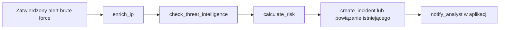

# SOAR Playbook Engine

Status: **projekt PHASE 0, bez implementacji**. Engine ma wykonywać trwały, odtwarzalny workflow na danych aplikacji. Wszystkie działania, które mogłyby zmienić rzeczywistą infrastrukturę, są wyłącznie symulacją. Nie powstaje ogólny runner komend.

## Model i granice zakresu

Playbook v1 to skończona, sekwencyjna lista kroków ze znanego rejestru akcji. Maksymalnie 20 kroków, bez pętli, dowolnego kodu, szablonów wykonujących funkcje, skryptów shell i adresów webhook podanych przez użytkownika. Każda akcja ma typowany input/output, limit rozmiaru i udokumentowane efekty. Proste referencje do wyniku wcześniejszego kroku używają walidowanej ścieżki pola, nie `eval` ani Jinja wykonującej kod. Brakujący lub źle typowany output przerywa workflow czytelnym błędem.

| Encja PostgreSQL | Ważne pola i ograniczenia |
| --- | --- |
| Playbook definition | ID, nazwa, opis, owner, status draft/published/disabled, audit |
| Playbook version | Niezmienny dokument zwalidowanej listy kroków, version, checksum, opublikował/czas |
| Playbook run | UUID, wersja playbooka, trigger/source ID, requested_by, `execution_mode=simulation`, stan, cancellation_requested, daty, correlation ID |
| Step execution | Run ID, step ID, action/version, waiting/running/completed/failed, input hash, output, attempts, error code, next_attempt_at, lease/fencing token |
| Step attempt | Niezmienny rekord próby, czas start/end, numer próby, wynik, zredagowany błąd |
| Action effect | Unikalny klucz efektu `(run_id, step_id, action_version)`, wynik i ID obiektów utworzonych w aplikacji |
| Outbox | Wiadomość o uruchomieniu następnego kroku zapisana w tej samej transakcji co stan |

Run zawsze wskazuje konkretną opublikowaną wersję. Edycja definicji tworzy nową wersję i nie zmienia działania już uruchomionego run. Celery/Redis dostarcza zawiadomienia; PostgreSQL przechowuje autorytatywny postęp. UI nigdy nie wyznacza stanu workflow tylko z Celery result backend.

Run dziedziczy `dataset_id`, `mode=live/replay` i namespace źródłowego alertu/sprawy. Osobne pole `execution_mode=simulation` dotyczy polityki akcji SOAR i pozostaje obowiązkowe w obu kontekstach. Dla replay wejścia i wersje enrichment są przypięte do scenariusza; engine nie pobiera późniejszej reputacji IOC ani bieżącego czasu jako faktu detekcji. Czasy prób wykonania workflow pozostają rzeczywistymi czasami audytu. Efekty nie przechodzą z datasetu demo do live.

## Rejestr akcji

| Akcja | Źródło i efekt | Reguła bezpieczeństwa |
| --- | --- | --- |
| `enrich_ip` | Walidacja/kanonizacja adresu i lokalna tabela fixture/context | Brak DNS, geolokalizacji online i HTTP |
| `check_threat_intelligence` | Odczyt lokalnej wersji IOC i dopasowania | Brak VirusTotal/AbuseIPDB/OTX w MVP |
| `calculate_risk` | Wywołanie deterministycznego silnika na utrwalonych wejściach | Zapisuje wersję i składniki; identyczne wejścia dają identyczny wynik |
| `create_incident` | Wywołuje usługę spraw, zwraca istniejący lub nowy incident ID | Respektuje korelację i unikalność, bez jednego nowego incydentu na retry |
| `notify_analyst` | Tworzy wpis w lokalnej skrzynce aplikacji | Brak e-mail, Slack, Teams i zewnętrznych webhook |
| `simulate_block_ip` | Zapisuje co zostałoby zablokowane i dlaczego | `simulated=true`; brak zmiany firewalla |
| `simulate_isolate_host` | Zapisuje plan izolacji i oczekiwany efekt | `simulated=true`; brak polecenia do EDR/hosta |

Run oznaczony simulation może tworzyć rzeczywiste obiekty **w aplikacji**: incydent, ocenę ryzyka, audit i lokalne powiadomienie. Interfejs rozróżnia te efekty od mock zmian infrastruktury. Parametr `execution_mode=live` jest niedozwolony, także dla Admina; `mode=live` może oznaczać wyłącznie namespace danych wejściowych. Nie ma przełącznika środowiska, który potajemnie zmienia mock w realny connector. Każda przyszła integracja wymaga nowego ADR, uprawnień i kontraktu adaptera.

## Przykład: Brute Force Response

W pierwszej wersji operator uruchamia zatwierdzony playbook z widoku alertu/incydentu. Publikacja playbooka jest zastrzeżona dla Manager/Admin, wykonanie opublikowanej wersji dla Analyst/Manager/Admin. Automatyczny trigger po typie alertu może zostać dodany po testach pętli i limitów; nie jest niejawnie włączony przez import definicji. Klucz automatycznego triggera, jeżeli powstanie, ma unikalność `(alert_id, playbook_version_id, trigger_policy_version)`.

`create_incident` najpierw używa istniejącego powiązania alertu z otwartą sprawą, a w przeciwnym razie tej samej usługi korelacji/tworzenia co pozostały pipeline. Nie implementuje konkurencyjnej logiki grupowania. Jeśli sprawa jest zamknięta, stosuje reguły nowej sprawy powiązanej opisane w [incident-response.md](incident-response.md). Dwie równoległe ścieżki utworzenia wymagają wspólnego unikalnego klucza korelacji i obsługi konfliktu transakcyjnego.

## Stany i semantyka retry

Stan run: `queued`, `running`, `completed`, `failed`, `cancelled`. Stany kroku wymagane przez projekt: `waiting`, `running`, `completed`, `failed`.

1. API zapisuje run, kroki `waiting`, audit oraz outbox w jednej transakcji. `POST` przyjmuje idempotency key; powtórzenie z innym body daje 409, z tym samym zwraca istniejący run.
2. Dispatcher wysyła do Celery tylko ID; zatwierdzenie wysyłki może się powtórzyć. Worker atomowo przejmuje gotowy krok przez warunek stanu i lease, zwiększając fencing token.
3. Przed rozpoczęciem sprawdza anulowanie, uprawnienie inicjatora, aktywność konta, publikację/wyłączenie playbooka oraz schema version. Odebranie uprawnień w trakcie pracy zatrzymuje kolejne kroki.
4. Efekt lokalny, zapis `action_effect`, ukończenie kroku, audit i outbox kolejnego kroku powstają w tej samej transakcji PostgreSQL. Stary worker nie może zatwierdzić efektu po utracie lease: transakcja weryfikuje bieżący fencing token.
5. Jeśli worker padnie po commicie przed ACK, ponowne wykonanie odczytuje istniejący efekt i output. Nie tworzy nowego incydentu/powiadomienia. Jeżeli padnie przed commitem, brak efektu pozwala na bezpieczne ponowienie.
6. Reconciler okresowo znajduje `waiting` gotowe do uruchomienia i `running` z wygasłym lease. Nie polega na istnieniu wiadomości w Redis; po restarcie publikuje brakujące zawiadomienia przez outbox.

Nie obiecujemy exactly-once dostarczania wiadomości. Gwarancją docelową jest at-least-once delivery plus pojedynczy utrwalony efekt lokalny dzięki kluczom i transakcjom. Dokumentacja [Celery Tasks](https://docs.celeryq.dev/en/stable/userguide/tasks.html) opisuje możliwość wielokrotnego uruchomienia i ograniczenia `acks_late`; samo późne ACK nie implementuje idempotencji ani trwałego workflow.

Błąd chwilowy ma maksymalnie 3 próby łącznie, domyślnie z odstępami 5 s i 20 s oraz ograniczonym jitter. Niepoprawny input, brak permission i nieznana akcja są błędami trwałymi bez retry. Błąd próby zapisuje się w `step_attempt`; krok wraca do `waiting` z `next_attempt_at` i `last_error`, jeżeli pozostał retry budget. Stan `failed` oznacza wyczerpany limit lub błąd trwały. Timeout kroku: 30 s; deadline całego run: 10 min. Timeout nie jest dowodem braku efektu, dlatego wznowienie najpierw sprawdza effect ledger.

Run z błędem jest terminalny; ponowna próba z UI tworzy nowy run z `replay_of` i wyraźnym podglądem planowanych efektów. Usługa domenowa nadal stosuje deduplikację incydentów. Celowe nowe lokalne powiadomienie po ręcznym replay jest osobnym efektem nowego run i musi być jawnie oznaczone jako powtórzenie. Nie przestawiamy ukończonych kroków starej historii na waiting.

## Anulowanie i awarie

Anulowanie jest poleceniem domenowym z audytem, a nie `terminate` dowolnego procesu Celery. Ustawia `cancellation_requested` i blokuje przyjmowanie następnych kroków. Worker sprawdza flagę przed zatwierdzeniem efektu; serializacja na run rozstrzyga wyścig commit–cancel. Jeżeli efekt zatwierdzono wcześniej, zostaje on zachowany i widoczny. Engine nie obiecuje wycofania wcześniejszych skutków.

Po zakończeniu aktywnej próby run przechodzi do `cancelled`. Nierozpoczęte kroki pozostają `waiting` z `not_executed_reason=run_cancelled`; UI pokazuje je jako niewykonane, a reconciler filtruje terminalne run. To pozwala zachować cztery stany kroku bez mylenia anulowania z awarią. Powtórzenie cancel jest idempotentne. Zakończony run nie może być anulowany wstecz.

Awaria Redis nie usuwa historii ani zaakceptowanego run; wskaźnik kolejki pokazuje opóźnienie. Awaria PostgreSQL nie pozwala rozpocząć ani potwierdzić efektu. Awaria ClickHouse może uniemożliwić enrichment wymagający analityki, ale nie zamienia braku danych w „brak zagrożenia”. Output opisuje `unavailable` albo trwały/ponawialny błąd, zgodnie z kontraktem akcji.

## API, UX i audyt

Planowane endpointy: `GET/POST /api/v1/playbooks`, `POST /playbooks/{id}/versions`, `POST /playbooks/{id}/publish`, `POST /playbooks/{id}/runs`, `GET /playbook-runs/{id}`, `POST /playbook-runs/{id}/cancel`. Wszystkie względne ścieżki mają prefiks `/api/v1`. Wersje draft wymagają walidacji wszystkich kroków przed publikacją; nie można uruchomić nieopublikowanego YAML.

UI pokazuje nazwę i wersję, `SIMULATION`, inicjatora, target alert/incident, postęp i czas każdego kroku, numery prób, bezpieczny input/output, lokalne efekty i przyczynę zatrzymania. Audit zapisuje definicję/publikację/start/cancel i każdą zmianę kroku. Surowe sekrety, pełne tokeny i dane połączenia nie trafiają do output. Max output: 64 KiB/krok; większy wynik wymaga kontrolowanego evidence, bez cichego obcięcia dowodu.

## Kryteria odbioru

1. Pięć kroków przykładowego playbooka wykonuje się na prawdziwych obiektach pipeline, a wynik i audit pozostają po restarcie API/worker/Redis.
2. Test zabija worker przed efektem, po efekcie/commicie i przed ACK; po rekoncyliacji istnieje jeden lokalny efekt kroku.
3. Dwaj workerzy na ten sam krok nie zatwierdzają podwójnego efektu. Worker z wygasłym fencing tokenem nie może go zapisać.
4. Błąd chwilowy respektuje limit prób, błąd trwały nie jest ponawiany, a terminalny run nie zostaje podjęty przez reconciler.
5. Cancel przed startem, podczas próby i po commicie ma opisane, powtarzalne wyniki; wcześniejsze efekty nie znikają z historii.
6. Zmiana definicji w czasie run nie zmienia jego wersji. Odebranie permission lub wyłączenie playbooka zatrzymuje kolejne kroki.
7. `execution_mode=live`, nieznana akcja, shell, dynamiczny import, endpoint HTTP i path traversal w definicji są odrzucone przed utworzeniem run.
8. Test z adresem IOC wskazującym localhost/metadata/publiczny host potwierdza brak DNS/HTTP/połączenia do celu. Powiadomienie powstaje wyłącznie w lokalnej skrzynce aplikacji.
